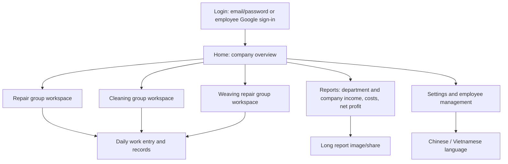

# SIGMA ColorCare — Approved first-version UI flow

This document is the implementation baseline for the first-version interface. It is not permission to change business rules or replace the existing Firebase project.

## Canonical user flow

## Navigation and layout

- Mobile-first layout; desktop adapts without changing the information hierarchy.
- Primary bottom navigation: Home, Reports, Settings.
- The three department workspaces are entered from Home and remain independent.
- Use concise cards and grouped panels. Do not place every feature in one continuous home page.
- Keep the two visual modes as glassmorphism: light glass and dark glass, with gradient atmospheric backgrounds, translucent surfaces, blur, fine highlights and clear contrast.
- The login screen must display the SIGMA ColorCare brand mark and product name.

## Business rules that the UI must preserve

- Three independent groups: repair = 1, cleaning = 2, weaving repair = 3.
- Currency is VND/₫ only. Net profit = total income − total costs.
- Record department/company income, wages, materials and operating expenses; show department and company profit/loss.
- Support long-form report sharing.
- Global Chinese / Vietnamese language switching.
- Do not introduce customer, style number, color, or order-number fields.
- Employee management and access control remain separate from production entry.
- Do not rebuild Firebase, replace the administrator UID, clear Firestore data, or weaken security rules.

## Implementation sequence

1. Restore brand identity and login presentation.
2. Reconcile the current six-workspace navigation with the approved Home / Reports / Settings hierarchy.
3. Implement and verify the home overview and independent department workspaces.
4. Complete reports, long-report sharing, settings and employee management.
5. Run syntax, Firestore authorization, mobile layout and regression tests before deployment.

## Brand asset note

The repository currently contains `icons/icon-192.png` and `icons/icon-512.png`. They are blue rounded-square app marks with a white “S”, not a separately supplied corporate vector logo. The login now uses the existing repository app mark and the SIGMA ColorCare wordmark; do not describe this as an official corporate logo unless the user supplies or confirms that asset.
